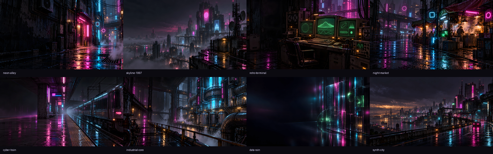

# Neon District 1997

Tema oscuro para **Omarchy 4.0.6**, inspirado en el cyberpunk imaginado en los años noventa: lluvia urbana, CRT voluminosos, acero húmedo, tecnología analógica y neón magenta/cian. Superficies casi negras y luz localizada para mantener la legibilidad al programar.

**v1.0.0 preparada; todavía no publicada.** Activación real satisfactoria en la instalación de referencia. El usuario aprobó apariencia general, colores y los ocho wallpapers. Hay [pruebas manuales pendientes](docs/manual-tests.md), incluida la de bloqueo/desbloqueo. MIT cubre código, configuración, documentación y prompts originales cuyos derechos puedan licenciarse. El titular confirmado es **Litotep (2026)**; los recursos gráficos y capturas tienen tratamiento separado. Véase [licencias](docs/licensing.md).



Esta cuadrícula de 1920×600 muestra la colección; no es una captura del escritorio. Se utiliza como vista previa provisional de v1.0.0; las capturas reales no son un requisito de este cierre.

## Paleta

| Uso | Hexadecimal |
|---|---|
| Fondo principal / secundario | `#0B0A10` / `#17141F` |
| Fondo profundo / más profundo | `#05050A` / `#030306` |
| Texto principal / secundario | `#E6E0FF` / `#A79CC9` |
| Texto claro / brillante | `#D3C8F3` / `#F6F2FF` |
| Acento magenta / cian | `#FF4FD8` / `#39D5FF` |
| Violeta para texto | `#A18CFF` |
| Verde / amarillo | `#72F1B8` / `#FFD166` |
| Rojo / naranja / marrón | `#FF5A5F` / `#FFAA70` / `#C28A66` |
| Selección / texto seleccionado | `#30223E` / `#F6F2FF` |
| Borde activo / inactivo | `#FF4FD8` / `#77678F` |

[colors.toml](colors.toml) incluye todos los colores semánticos y brillantes; la [documentación técnica](docs/technical.md) detalla ANSI y contrastes. El neón se reserva para acentos. No se añaden scanlines ni efectos CRT que dificulten leer código.

## Requisitos y compatibilidad

- Omarchy **4.0.6** (paquete de referencia 4.0.6-1), motor nativo `colors.toml`, Hyprland Lua y Quickshell.
- Git para clonar. Iconos **Yaru-magenta-dark** disponibles localmente; este paquete solo contiene su nombre, no los iconos.
- Wallpapers 16:9 de 1920×1080, probados en un escritorio de dos monitores Full HD. No son un panorama continuo ni una imagen 3840×1080.
- Kitty es opcional y utiliza un perfil independiente. No se requiere GPU, NCNN ni modelos para instalar o visualizar el tema.

No se garantiza compatibilidad con Omarchy antiguo basado en Waybar/Hyprland conf, otros forks o versiones futuras. Véase [compatibilidad](docs/compatibility.md).

## Instalación sin activar

Descarga o clona el repositorio, entra en su directorio y revisa los archivos. Antes de publicarlo todavía no hay una URL remota disponible. Desde la raíz de un clon local:

```bash
theme_dir="$HOME/.config/omarchy/themes/neon-district-1997"
if [ -e "$theme_dir" ] || [ -L "$theme_dir" ]; then
  echo 'El destino existe: conserva una copia y revisa los cambios antes de actualizar.'
else
  mkdir -p "$(dirname "$theme_dir")"
  cp -a . "$theme_dir"
fi
```

Este procedimiento no cambia el tema ni sobrescribe un destino existente. El comando nativo `omarchy theme install URL` **instala y activa inmediatamente**; además elimina un directorio previo con el mismo nombre. No se recomienda para una revisión previa o una actualización sin respaldo. Cuando exista el remoto, el nombre `omarchy-neon-district-1997-theme` se normalizará a `neon-district-1997` en Omarchy 4.0.6.

## Antes de activar

Registra el tema y conserva una copia real del wallpaper actual: el directorio generado `current/theme` se reemplaza al cambiar de tema. Respalda también los destinos de las aplicaciones que utilices según [instalación y reversión](docs/install-and-restore.md).

```bash
omarchy theme list
omarchy theme set neon-district-1997
```

Ejecuta la activación desde tu sesión gráfica, después de revisar y respaldar. Se utiliza exclusivamente el sincronizador nativo, que puede cambiar preferencias de aplicaciones, iconos y políticas de color del navegador mediante su helper privilegiado. No se distribuyen instaladores ni scripts de activación.

## Wallpapers y terminal

```bash
omarchy theme bg next
omarchy theme bg set "$HOME/.config/omarchy/themes/neon-district-1997/backgrounds/neon-alley.webp"
kitty --config "$HOME/.config/omarchy/themes/neon-district-1997/extras/kitty-preview.conf"
```

Los hooks personales pueden escoger otro fondo después de activar; este paquete no modifica esos hooks. El perfil de Kitty incluye primero `~/.config/kitty/kitty.conf` y aplica luego la paleta de prueba; no escribe en la configuración principal. Si Kitty usa una ubicación distinta, ajusta esa inclusión en una copia del perfil.

## Restauración

Desde la sesión gráfica, aplica el nombre del tema registrado antes de activar y selecciona después la copia conservada del wallpaper anterior:

```bash
omarchy theme set "$previous_theme"
wallpaper_copy=$(cat "$backup_dir/wallpaper-copy.txt")
omarchy theme bg set "$backup_dir/$wallpaper_copy"
```

Las variables se preparan en [instalación y reversión](docs/install-and-restore.md). Cambiar de tema por sí solo no recupera exactamente preferencias previas, extensiones locales o políticas del navegador: restaura selectivamente los respaldos de esos destinos. No vuelques un archivo de respaldo sobre todo el sistema ni borres cambios posteriores.

## Colección y procedencia

Ocho fondos: `neon-alley`, `skyline-1997`, `retro-terminal`, `night-market`, `cyber-train`, `industrial-core`, `data-rain` y `synth-city`.

Imágenes generadas con IA mediante `image_gen`; originales de **1672×941**, reconstrucción Real-ESRGAN x4 a **6688×3764**, reducción proporcional Lanczos y WebP Q95 a **1920×1080**. La superresolución no es detalle nativo 4K y puede reconstruir detalles inventados. Los ocho resultados fueron revisados y aprobados visualmente. No se usaron fotografías de terceros para sustituir la generación.

[Manifiesto y hashes](docs/wallpapers.json) · [Prompts](docs/wallpaper-prompts.md) · [Procesamiento y créditos](docs/provenance.md) · [Validación](docs/validation.md) · [Pruebas manuales](docs/manual-tests.md) · [Changelog](CHANGELOG.md) · [Contribuir](CONTRIBUTING.md).

## Licencia y limitaciones

**MIT para código, configuración, documentación y prompts originales**, incluidos los ajustes propios de extras, en la medida en que puedan licenciarse. [LICENSE](LICENSE) contiene las condiciones estándar íntegras y el aviso **Copyright (c) 2026 Litotep**, confirmado por el titular. El material derivado de Omarchy conserva su [aviso MIT original](LICENSES/Omarchy-MIT.txt). No se extiende esa concesión a aportaciones ajenas ni se reclaman derechos inexistentes.

Los ocho wallpapers, preview.png y futuras capturas **no están cubiertos por MIT automáticamente**. Su [fundamento de distribución y límites](docs/ASSET-LICENSING.md) distingue uso contractual, derecho de autor y licencias de herramientas; su inclusión en el tema no implica exclusividad ni declaración de dominio público. [Componentes de terceros](docs/THIRD-PARTY.md).

La transparencia de barra es una preferencia local, independiente del tema. El paquete no distribuye shell.json ni complementos. Véase [revisión de transparencia](docs/shell-state-review.md). Los contrastes calculados sobre fondos sólidos no garantizan el mismo resultado sobre un wallpaper visible a través de la barra.

Las pruebas manuales específicas pendientes se declaran como limitaciones conocidas de v1.0.0; no impiden preparar esta versión. Se usa preview.png como vista previa provisional. La colección de wallpapers está aprobada visualmente, lo que no equivale a verificar cada aplicación o el bloqueo. [Preparación de publicación](docs/release.md) y [auditoría de privacidad](docs/privacy-audit.md).
